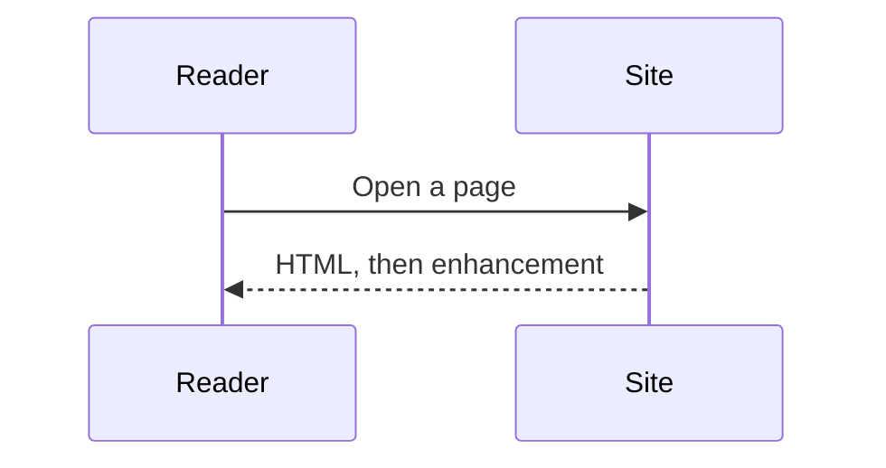

`Mermaid` draws a diagram from a text description. You rarely write the component yourself: a fenced code block
with the language `mermaid` becomes one. See [Diagrams and math](../guides/diagrams-and-math.mdx) for the guide.

````mdx

````


## As a component

Use the component directly to put a diagram inside another component, such as a [Tile](./tile.mdx) preview or a
[Frame](./frame.mdx), by passing the diagram text as `chart`:

```mdx
<Frame caption="The build">
  <Mermaid chart={'graph LR\n  A[Write] --> B[Build] --> C[Ship]'} />
</Frame>
```

<TypeTable
  type={{
    chart: {
      type: 'string',
      required: true,
      description: 'The diagram in Mermaid syntax.',
    },
  }}
/>

## How it behaves

- The Mermaid library is downloaded only on pages that have a diagram, and drawn in the browser.
- The diagram is redrawn when the theme changes between light and dark.
- Diagrams are drawn in strict mode: links and scripts in diagram text are not run.
- Until the library loads, and if drawing fails (for example a syntax error), the diagram's source text is shown,
  so the page is never blank.
- The diagram is exposed to assistive technology as an image labelled "Diagram". Describe what it shows in the text
  around it, so readers who cannot see it still get the point.
- It scrolls sideways inside its box if it is wider than the page.
