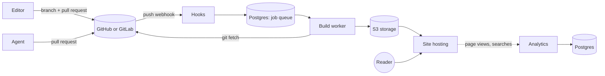

The library gives you a docs site. The platform is the set of services around it that a team usually wants next, and it is
open source and self-hostable with one command.

| Service            | What it does                                                                                                   | Guide                                              |
| ------------------ | -------------------------------------------------------------------------------------------------------------- | -------------------------------------------------- |
| **Hooks**          | Rebuilds the site on every push to your repository.                                                            | [Connect a repository](./connect-a-repository.mdx) |
| **Editor**         | Edit pages in the browser with a live preview. Saves are pull requests.                                        | [The editor](./editor.mdx)                         |
| **Analytics**      | Page views, searches (including the ones that found nothing), feedback, and AI-tool traffic. No personal data. | [Analytics](./analytics.mdx)                       |
| **Auth and teams** | Sign in with any OpenID Connect provider, teams with roles, API keys, private docs.                            | [Teams and sign-in](./teams-and-sign-in.mdx)       |
| **Agent**          | Watches your code and opens pull requests that update the docs. It never publishes.                            | [The docs agent](./agent.mdx)                      |
| **Site hosting**   | Serves each built site at its own address.                                                                     | [Connect a repository](./connect-a-repository.mdx) |

## Files stay the source of truth

Nothing you write lives in the platform. Your pages are MDX files in your Git repository, and the platform only reads and
writes them through Git:

- the editor creates a branch and a pull request, and you merge it;
- the agent opens pull requests and never pushes to your default branch;
- a build is triggered by a push, from a fresh checkout of the exact commit.

Delete the platform and your docs are exactly as they were. Move between self-hosting and a managed host and only the place
the builds run changes.

## How it fits together

It is one program run in several roles. `DOCKUDOS_SERVICES` picks the roles of a process (`web`, `hooks`, `analytics`, `auth`,
`editor`, `worker`, `agent`, `site`), so a small install runs one container and a large one scales the pieces separately.
The job queue is Postgres, so there is nothing else to operate.

## What you need

| Need                       | Notes                                                                                           |
| -------------------------- | ----------------------------------------------------------------------------------------------- |
| Postgres 14 or newer       | Application data and the job queue.                                                             |
| S3-compatible storage      | Built sites and uploads. MinIO, AWS S3, R2, Ceph. A local directory works for a single machine. |
| A Git host token           | GitHub or GitLab, to read repositories and open pull requests.                                  |
| An OpenID Connect provider | For sign-in. Without one, only API keys work.                                                   |
| A model key (optional)     | For the agent's drafts. Bring your own.                                                         |

## Choose how to run it

- **One machine:** [Docker Compose](./self-host-docker-compose.mdx). Postgres, storage, every service and a reverse proxy in one file.
- **A cluster:** [Kubernetes with Helm](./self-host-kubernetes.mdx). Scaling, ingress and secrets as values.
- **Just a site, no platform:** [static export](../guides/static-export.mdx) or the Dockerfile that `dockudos init` adds to your project.

The paid managed cloud runs this same software for you; see the [enterprise notes](https://github.com/dockudos/dockudos/tree/main/notes/enterprise).
