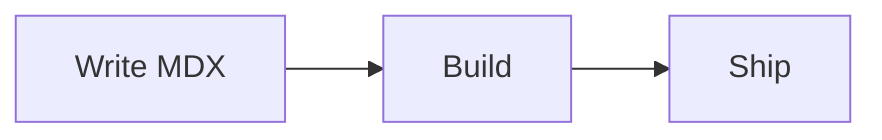

## Highlighting

```ts title="hello.ts" {2,4-5} showLineNumbers
export function greet(name: string) {
  const message = `Hello, ${name}`;
  console.log(message);
  return message.length;
}
```

```ts
const a = 1; // [!code highlight]
const b = 2; // [!code ++]
const c = 3; // [!code --]
```

## Code group

<CodeGroup>

```ts title="a.ts"
export const a = 1;
```

```js title="b.js"
export const b = 2;
```

</CodeGroup>

## Package managers

```package-install
npm install @dockudos/core -D
```

## TypeScript to JavaScript

```ts ts-to-js
interface User {
  name: string;
}
export function hello(user: User): string {
  return `Hi ${user.name}`;
}
```

## Twoslash

```ts twoslash
const point = { x: 1, y: 2 };
const sum = point.x + point.y;
```

## Diagram



## Math

Inline math $$E = mc^2$$ and a block:

$$
\int_0^1 x^2 \, dx = \tfrac{1}{3}
$$

## Images

A local image, sized automatically:


A public image:


